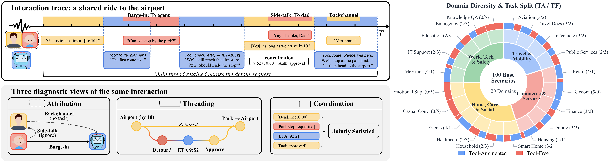

<div align="center">


# μ-Bench

### Benchmarking Multi-User Task Completion in Shared Interaction Voice Agents

[](LICENSE)
[](pyproject.toml)
[](cases/)

**Closed-loop, full-duplex evaluation for voice agents serving multiple users over a shared audio channel.**

[Overview](#benchmark-overview) · [Quick Start](#quick-start) · [Evaluation](#evaluation) · [Models](#supported-models-and-tracks) · [中文](README.zh-CN.md)

</div>

## Why μ-Bench?

Personal assistants help one person get things done. In shared activities—planning a trip, coordinating a meeting or updating a family schedule—one person's new request can change another person's plan. A shared voice assistant must remember each participant's requirements, check the consequences of revisions and resume unfinished requests as people interrupt, clarify or talk to one another.

**μ-Bench evaluates whether the assistant can complete this interdependent work within one evolving conversation.** Cases pair reactive multi-user interaction with explicit task goals and verifiable outcomes.

[](assets/figures/intro-teaser.pdf)

*An illustrative shared interaction: a park-stop request must fit an existing 10:00 airport deadline. Click the figure for the vector PDF.*

- **Reactive multi-user simulation.** Participants have individual profiles, goals and knowledge boundaries. An orchestrator, scriptwriter and voice actor generate interruptions, clarification and request revisions in response to the agent's played speech and actual tool effects.
- **Controlled comparisons.** 100 base scenarios span 20 domains. Each has eight matched variants across group size, acoustic profile and user comprehension, with fixed voice bindings and 3,200 reference recordings.
- **Task outcomes and ATC diagnostics.** Joint Task Success checks the applicable goals and constraints in one trajectory. Attribution, Threading and Coordination explain the interaction capabilities behind the outcome; authorization violations are reported separately.

## Benchmark Overview

| Track | Base scenarios | Cases | What establishes completion? |
|---|---:|---:|---|
| **Tool-Free** | 49 | 392 | Spoken answers, clarification, refusal and coordination |
| **Tool-Augmented** | 51 | 408 | Conversation plus actual virtual-tool execution and required business effects |
| **Full suite** | **100** | **800** | **Shared task completion across 20 domains** |

Each scenario has a **2 × 2 × 2** condition grid:

| Controlled factor | Matched settings |
|---|---|
| **Group size** | Small: 2–3 participants / large: 4–7 participants |
| **Acoustic profile** | Clean / realistic |
| **User comprehension and follow-up demand** | Strong / weak |

The [case catalog](cases/) supports comparisons that hold the scenario and two factors fixed while varying the third.

<details>
<summary><b>Explore the 20 domains and their tasks</b></summary>

| Domain | Tool-Augmented (51 Base / 408 Cases) | Tool-Free (49 Base / 392 Cases) |
| :--- | :--- | :--- |
| **Aviation & Airport** | Separate rebooking, seat preference correction, cancellation authority conflict | Gate broadcast filtering, mobility assistance restatement |
| **Retail & E-Commerce** | Cancellation withdrawal, address correction, return side-talk, quantity revision | Product comparison and backchannel handling |
| **Telecommunications** | Data plan top-up, lost-number correction, reboot objection, roaming translation, post-outage fee waiver | *None* |
| **Finance & Billing** | Auto-debit conflict, multi-user currency conversion, invoice amount correction | Benefit privacy protection, unsupported transfer refusal & thread resumption |
| **Housing & Relocation** | Filter coordination, commute comparison, accessibility addendum, viewing scheduling | Guarantor advice vs. tenant consent disambiguation |
| **Travel Documents** | Document number correction, multi-user renewal, translated relay | Adult vs. parental authority conflict, side-talk document privacy |
| **Knowledge QA** | *None* | Answer attribution, coreference resolution, expert counterexample, translation query, child-level explanation |
| **Casual Conversation** | *None* | Story follow-up continuation, backchannels, roommate side-talk, temporary digression return, quiet participant inclusion |
| **Emotional Support** | *None* | Dual-party needs, comfort target identification, explanation correction, emotion source attribution, grounded empathy |
| **Shared Smart Home** | Multi-user timers, media playback control, shared shopping list | Thermostat objection resolution, visitor access authorization |
| **In-Vehicle Collaboration** | Destination correction, music side-talk during navigation, safety report attribution | Latecomer summary, trip negotiation and speaking equity |
| **Meeting Collaboration** | Vote recording, owner/deadline correction, dissent logging, deadline update | Quoted opinion vs. personal vote disambiguation |
| **Education & Learning** | Student answer logging and grading, project task division | Peer whispering filtering, lecture backchannels, translated answer attribution |
| **Healthcare & Caregiving** | Appointment coordination, medication list source logging | Accessibility needs, visitor privacy, existing guideline restatement |
| **Dining & Hospitality** | Party size update, ordering side-talk filtering, bill splitting | Allergy attribution, late-joining roommate privacy |
| **Public Services** | Accessible transit booking, interpreter scheduling | Borrowing privacy, resident speaking turn, plain-language notice |
| **IT Support** | Service restart authorization, rollback target correction | Credential reset privacy, troubleshooting backchannels, multi-thread follow-up |
| **Events & Entertainment** | Ticket allocation, collaborative playlist, accessible seating, schedule update | Parental content restriction enforcement |
| **Household Coordination** | Pickup/drop-off division, chore assignment | Eldercare scheduling, calendar privacy, packing list threading |
| **Emergency & Incident** | Missing person description logging, roll-call status logging | Evacuation instruction clarification, dispatch relay, shelter resource negotiation |


</details>

## Quick Start


### 1. Clone and validate

The runner supports **Linux, Python 3.10–3.12**. Install Git, `ffmpeg`, `libsndfile` and the build tools required by your selected backends. This checkout includes the voice catalog, **3,200 reference recordings** and fixed participant-to-voice bindings; model weights and API credentials are supplied separately.

**Reproduction commands — new checkout:**

```bash
export MUBENCH_REPO="$HOME/mu-bench"
git clone https://github.com/lqh1106/mu-bench.git "$MUBENCH_REPO"
cd "$MUBENCH_REPO"
bash scripts/bootstrap.sh
.venv/bin/python -m mubench validate --assets
```

### 2. Deploy services and configure a model

Follow [Installation](docs/INSTALL.md) for complete service commands. Keep the runner, speech services and each native model in their own environments.

| Component | Included implementation | Configuration |
|---|---|---|
| User TTS | CosyVoice HTTP service | Voice catalog, TTS weights and `speech.tts_endpoint` |
| Assistant ASR | Faster-Whisper large-v3 | ASR weights and the gateway's ASR address |
| ASR/text gateway | Included HTTP router | Text API address/key and a local gateway key |
| Simulator and judge | OpenAI-compatible text API | `text.base_url`, `text.api_key`, `text.model` (default `gpt-6-luna`) |
| Tested agent | Native GPU service or cloud adapter | `sut` section: model, endpoint(s) and provider credentials |

**Reproduction commands — prepare local configuration:**

```bash
export MUBENCH_REPO="$HOME/mu-bench"
cd "$MUBENCH_REPO"
cp .env.example .env
cp configs/run.native.example.json local.native.json
cp configs/run.closed.example.json local.closed.json
```

Fill `.env` and your chosen local config using [INSTALL.md](docs/INSTALL.md). The templates read secrets from environment variables. Native checkpoint paths and separate environments are documented in [Models](docs/MODELS.md). MOSS provides [audio](configs/run.moss.example.json) and [tool-capable](configs/run.moss.tools.example.json) templates. Local configs, tokens, weights and results stay outside version control.

### 3. Run a smoke case, then scale

**Reproduction commands — native Tool-Free audio, after service setup:**

```bash
export MUBENCH_REPO="$HOME/mu-bench"
cd "$MUBENCH_REPO"
set -a
source .env
set +a
.venv/bin/python -m mubench run --config local.native.json --subset tool_free --case airline_04_gate_announcement_collision__g-small__a-clean__c-strong --workers 1
```

**Reproduction commands — Tool-Augmented audio with a configured cloud provider:**

```bash
export MUBENCH_REPO="$HOME/mu-bench"
cd "$MUBENCH_REPO"
set -a
source .env
set +a
.venv/bin/python -m mubench run --config local.closed.json --subset tool_augmented --case hospitality_01_party_size_fix__g-small__a-clean__c-strong --workers 1
```

After the run, open `formal/<case>/score.json` for the task verdict, `atc_score.json` for diagnostics and `audio/both.wav` to hear the two-channel conversation. These live under `output_root/<model>/<subset>/<condition>/`, where the condition is `baseline` or an ablation arm; the difficulty settings are encoded in the case ID. [Output layout, full-subset runs and parallelism →](docs/USAGE.md)


### Output layout

```text
output_root/<model>/<subset>/<condition>/
├── claims/                         # Per-case locks shared by workers
├── runs/<case_id>/attempt_001/      # Attempt logs and retained evidence
└── formal/<case_id>/                # Completed, sealed result
    ├── score.json                  # Task verdict and itemized assessment
    ├── atc_score.json              # Attribution / Threading / Coordination
    ├── rice_score.json             # Preserved source components
    └── audio/both.wav              # Final two-channel session audio
```

`<subset>` is `tool_free` or `tool_augmented`. `<condition>` is `baseline`, `serial`, `serial_identity` or `serial_identity_semantics`; group size, acoustics and comprehension are part of `<case_id>`.

Automatic cleanup runs only after the required scores and final stereo audio are present. It removes redundant audio fragments, mono stems and temporary oracle audio while preserving the final recording, ASR, trajectories, tool records and judge audits. Publication uses hardlinks where possible to avoid duplicating file contents. Incomplete evidence is retained. [Output and cleanup details →](docs/USAGE.md#outputs-and-cleanup)

## Architecture and Evaluation Protocol

**Case playbook → reactive users ⇄ tested agent and tools → recorded evidence → task and ATC scores**

1. **Define the shared work.** Each case specifies participants, their knowledge, goals, constraints, initial assistant materials and an event graph. Tool cases also define executable APIs and an initial business state.
2. **Run the conversation.** The orchestrator releases events from actual observations. The scriptwriter generates participant-specific utterances, and the voice actor renders them using fixed reference voices. The agent's audible output and tool effects shape subsequent events.
3. **Preserve delivered evidence.** The runner records played user and assistant audio, assistant ASR, event delivery, tool arguments/results and final business state. Playback receipts and logical time establish which information was available before an action or answer.
4. **Verify completion.** Deterministic checks evaluate applicable tool effects and business state. Semantic judges assess the authored obligations against the recorded evidence, followed by independent review, conflict arbitration when needed and targeted source checks.

The [Protocol](docs/PROTOCOL.md) specifies registration, public participant codes, tool disclosure, playback, interruption and logical-time pauses during simulator computation. [Architecture](docs/ARCHITECTURE.md) maps these components to the implementation.

## Evaluation

**Task Success** measures whether the case's applicable goals, required business effects, final state and privacy constraints are satisfied. **Authorization and caller-source violations are reported separately**, with the underlying records retained.

**ATC** explains the interaction capabilities behind the outcome:

| Axis | Meaning | Component mapping |
|---|---|---|
| **A — Attribution** | Speaker, addressee and request attribution | `A = Routing` |
| **T — Threading** | Keeping and resuming task threads | `T = Continuity` |
| **C — Coordination** | Boundary compliance and applicable multi-user service equity | `C = (Isolation + Equity) / 2`; when Equity is inapplicable, `C = Isolation` |

Scores use `[0, 1]`; inapplicable Equity is excluded, while an observed zero is included. ATC is computed per case from the preserved RICE components without another judge call.

Evaluation combines deterministic tool/state checks, itemized semantic assessment, independent full review, conflict arbitration when needed and targeted source review. In tool cases, the explicit public `caller_id` identifies the requester for execution-time permission checks; semantic review separately checks whether that caller matches the actual source of the request. Judges assess the case's designed goals; simulator-added requests do not become mandatory goals. Complete trajectories can be judged offline without replaying the agent.

[Scoring and evidence flow](docs/EVALUATION.md) · [Tool evaluation contracts](docs/TOOL_EVALUATION.md) · [Outputs and automatic cleanup](docs/USAGE.md#outputs-and-cleanup)

## Supported models and tracks

| Integration | Tool-Free audio | Tool-Augmented audio | Identity/semantic ablations |
|---|:---:|:---:|:---:|
| MiniCPM-o | ✓ | — | ✓ |
| Moshi, Freeze-Omni, FLM-Audio, Voila, Raon-SpeechChat, PersonaPlex, Lychee-FD | ✓ | — | — |
| OpenAI Realtime, Grok voice, Gemini Live | ✓ | ✓ | — |
| MOSS Live | ✓ | ✓ | ✓ |

[Model deployment](docs/MODELS.md) provides checkpoint information, isolated environments and provider configuration. Availability and capacity depend on the configured endpoint.

**Capability ablations.** Three cumulative conditions preserve the task goals and source material: **serial turns → serial + identity → serial + identity + structured semantics**. The 1,176 transformed cases are shared across models; MiniCPM and MOSS implement the required auxiliary-input transports. [Settings and verified delivery →](docs/USAGE.md#capability-ablations)

**Text diagnostics.** An optional streaming text track uses speaker-name-labeled utterances, logical-time prefix interruption and the same virtual tools. It needs no speech services or GPU. The default tested chat model is `qwen3.8-flash`. [Text setup and interpretation →](docs/TEXT_TRACK.md)

## Documentation

| I want to… | Start here |
|---|---|
| Deploy TTS, ASR and the runner | [Installation](docs/INSTALL.md) |
| Configure or deploy a tested model | [Models](docs/MODELS.md) |
| Run a full subset, ablation or offline evaluation | [Usage](docs/USAGE.md) |
| Understand shared-channel interaction | [Protocol](docs/PROTOCOL.md) |
| Inspect task decisions and diagnostic scores | [Evaluation](docs/EVALUATION.md) |
| Run the streaming text track | [Text diagnostics](docs/TEXT_TRACK.md) |
| Locate components or automate installation | [Architecture](docs/ARCHITECTURE.md) · [Agent setup](AGENTS.md) |

## Citation and license

Author and maintainer: [Lin Qihao (@lqh1106)](https://github.com/lqh1106). Software citation metadata is in [CITATION.cff](CITATION.cff).

Original benchmark code and case content use [Apache-2.0](LICENSE). Third-party code, voice assets and external weights retain their respective licenses; see [NOTICE](NOTICE) and [Third-party components](docs/THIRD_PARTY.md).
