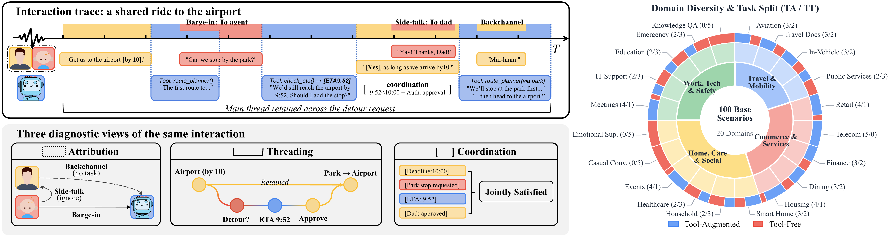

<div align="center">


# μ-Bench

### 面向共享语音助手的多人任务完成评测

[](LICENSE)
[](pyproject.toml)
[](cases/)

**在共享音频频道中，以闭环、全双工交互评测语音助手服务多位用户的能力。**

[概览](#benchmark-概览) · [快速开始](#快速开始) · [评分机制](#如何评价) · [模型适配](#支持的模型与实验设置) · [English](README.md)

</div>

## 为什么需要 μ-Bench？

个人助手帮助一个人完成事务。共同出行、会议协作和家庭安排中，一个人的新请求可能改变另一个人的计划。共享语音助手需要记住各人的要求，检查修改对已有安排的影响，并在插话、澄清和同伴交谈中接续未完成事项。

**μ-Bench 评价助手能否在一场持续演化的对话中，完成这些相互关联的共同事务。** 案例将响应式多人交互与明确的任务目标、可核验的结果连接起来。

[](assets/figures/intro-teaser.pdf)

*共享交互示意：去公园的新请求，需要满足已有的 10:00 机场到达时限。点击图片查看矢量 PDF。*

- **响应式多人模拟。** 各人具有独立的人物设定、目标与可知信息边界。调度器、编剧和配音器根据助手实际播放的语音与工具效果，组织插话、澄清和请求修订。
- **受控变量对比。** 20 个领域、100 个基础场景，每场景设置群体规模、声学风格和用户理解能力的八种配对变体，配有固定声纹绑定与 3,200 条参考录音。
- **任务结果与 ATC 诊断。** Joint Task Success 核验同一轨迹中适用目标与约束是否满足；归属、线程保持和协调指标解释结果背后的交互能力，授权违规单独报告。

## Benchmark 概览

| 子集 | 基础场景 | 案例 | 完成依据 |
|---|---:|---:|---|
| **无工具** | 49 | 392 | 口头回答、澄清、拒绝与协调 |
| **有工具** | 51 | 408 | 对话、真实虚拟工具执行及必要业务效果 |
| **完整集合** | **100** | **800** | **20 个领域的共享任务完成** |

每个场景设置 **2 × 2 × 2** 条件组合：

| 受控变量 | 配对设置 |
|---|---|
| **群体规模** | 小组：2–3 人／大组：4–7 人 |
| **声学风格** | 清晰／自然口语 |
| **用户理解及追问需求** | 强／弱 |

[案例集](cases/)支持固定场景及其余两项变量、只改变一项因素的对比。

<details>
<summary><b>展开查看 20 个领域及任务</b></summary>

| 领域 | 有工具任务 | 无工具任务 |
|---|---|---|
| 航空与机场 | 分别改签、座位偏好修订、取消权限冲突 | 登机口公告过滤、行动协助复述 |
| 零售与电商 | 取消撤回、地址纠正、退货侧谈、数量修订 | 产品比较与附和处理 |
| 电信服务 | 流量充值、丢失号码纠正、重启异议、漫游翻译、故障补偿 | — |
| 金融与账单 | 自动扣款冲突、多人换汇、发票金额修订 | 权益与账户隐私、拒绝不支持的转账并续接原任务 |
| 住房与选址 | 筛选协调、通勤比较、无障碍修订、看房安排 | 区分担保人建议与租户决定权 |
| 旅行证件 | 号码纠正、多人证件办理、翻译转述 | 成人与家长权限、侧谈证件隐私 |
| 知识问答 | — | 答案归属、指代、专家反例、翻译问题、儿童解释 |
| 日常交谈 | — | 故事续问、附和、室友侧谈、临时话题返回、安静成员发言 |
| 情绪支持 | — | 双方需求、安慰对象、解释纠正、情绪来源、具体共情 |
| 共享家居 | 多人计时、媒体播放、购物清单 | 恒温器异议、访客开门权限 |
| 车内协作 | 目的地纠正、导航中音乐侧谈、安全报告归属 | 后加入者摘要、行程协商与发言公平 |
| 会议协作 | 投票记录、负责人纠正、异议记录、截止时间更新 | 引用他人观点与本人投票的区分 |
| 教育与学习 | 答案记录与判分、项目分工 | 同伴耳语、讲解附和、翻译答案归属 |
| 医疗与照护 | 预约协调、用药清单来源记录 | 无障碍沟通、访客隐私、既有指南复述 |
| 餐饮与住宿 | 人数修订、点餐侧谈、分账 | 过敏归属、后加入室友的隐私 |
| 公共服务 | 无障碍交通预约、口译安排 | 借阅隐私、居民发言、通俗通知 |
| IT 支持 | 服务重启权限、回滚对象纠正 | 凭据重置隐私、排障附和、多线程跟进 |
| 活动与娱乐 | 票务归属、协作歌单、无障碍座位、日程修订 | 家长内容限制 |
| 家庭协调 | 接送分工、家务分配 | 长者照护、日历隐私、行李清单线程 |
| 应急与事件 | 走失者描述、点名状态记录 | 疏散指令、调度转述、避难所资源协商 |

</details>

## 快速开始


### 1. 克隆并验证

运行器支持 **Linux、Python 3.10–3.12**。安装 Git、`ffmpeg`、`libsndfile` 和所选后端要求的编译工具。仓库已包含声纹目录、**3,200 条参考录音**及固定参与者绑定；模型权重和 API 凭据单独配置。

**复现命令——新建本地副本：**

```bash
export MUBENCH_REPO="$HOME/mu-bench"
git clone https://github.com/lqh1106/mu-bench.git "$MUBENCH_REPO"
cd "$MUBENCH_REPO"
bash scripts/bootstrap.sh
.venv/bin/python -m mubench validate --assets
```

### 2. 启动服务并配置模型

[安装文档](docs/INSTALL.md)提供完整启动命令。运行器、语音服务及每个原生模型使用独立环境。

| 组件 | 实现 | 配置内容 |
|---|---|---|
| 用户 TTS | CosyVoice HTTP 服务 | 声纹目录、TTS 权重、`speech.tts_endpoint` |
| 助手 ASR | Faster-Whisper large-v3 | ASR 权重和网关使用的 ASR 地址 |
| ASR／文本网关 | 仓库内 HTTP 路由服务 | 文本上游地址、密钥及本地网关密钥 |
| 用户模拟器与评分器 | OpenAI 兼容文本 API | `text.base_url`、`text.api_key`、`text.model`，默认 `gpt-6-luna` |
| 待测模型 | 原生 GPU 服务或云端接口 | `sut` 中的模型、端点和提供方凭据 |

**复现命令——准备本地配置：**

```bash
export MUBENCH_REPO="$HOME/mu-bench"
cd "$MUBENCH_REPO"
cp .env.example .env
cp configs/run.native.example.json local.native.json
cp configs/run.closed.example.json local.closed.json
```

按 [INSTALL.md](docs/INSTALL.md) 填写 `.env` 与所选配置。示例通过环境变量引用密钥；模型路径和隔离环境见 [MODELS.md](docs/MODELS.md)。MOSS 提供[音频模板](configs/run.moss.example.json)及[有工具模板](configs/run.moss.tools.example.json)。本地配置、token、权重和运行结果不进入版本控制。

### 3. 先跑一案，再增加并发

**复现命令——服务就绪后运行原生模型无工具测试：**

```bash
export MUBENCH_REPO="$HOME/mu-bench"
cd "$MUBENCH_REPO"
set -a
source .env
set +a
.venv/bin/python -m mubench run --config local.native.json --subset tool_free --case airline_04_gate_announcement_collision__g-small__a-clean__c-strong --workers 1
```

**复现命令——使用已配置的云端模型运行有工具测试：**

```bash
export MUBENCH_REPO="$HOME/mu-bench"
cd "$MUBENCH_REPO"
set -a
source .env
set +a
.venv/bin/python -m mubench run --config local.closed.json --subset tool_augmented --case hospitality_01_party_size_fix__g-small__a-clean__c-strong --workers 1
```

运行结束后，在 `formal/<case>/` 中查看 `score.json` 的任务判定、`atc_score.json` 的诊断指标，并播放 `audio/both.wav` 回听对话。该目录位于 `output_root/<model>/<subset>/<condition>/` 下，condition 为基线或消融组，难度设置包含在 case ID 中。[输出结构、全量运行与并发设置 →](docs/USAGE.md)


### 输出结构

```text
output_root/<model>/<subset>/<condition>/
├── claims/                         # 工作进程共享的逐案锁
├── runs/<case_id>/attempt_001/      # 尝试日志及保留证据
└── formal/<case_id>/                # 完整封存结果
    ├── score.json                  # 任务判定及逐项核验
    ├── atc_score.json              # 归属／线程保持／协调
    ├── rice_score.json             # 保留的原始指标分项
    └── audio/both.wav              # 最终双声道会话录音
```

`<subset>` 为 `tool_free` 或 `tool_augmented`；`<condition>` 为 `baseline`、`serial`、`serial_identity` 或 `serial_identity_semantics`。群体规模、声学风格与理解能力编码在 `<case_id>` 中。

自动清理仅在必要评分与最终立体声音频就绪后执行，删除冗余音频碎片、单声道和临时 oracle 音频，保留最终录音、ASR、轨迹、工具记录与评价审计。发布时尽可能使用硬链接，避免重复占用文件内容空间；未完整尝试的证据保留。[输出及清理说明 →](docs/USAGE.md#outputs-and-cleanup)

## 架构与测评协议

**案例 Playbook → 响应式用户 ⇄ 待测助手与工具 → 交互证据 → 任务与 ATC 分数**

1. **定义共同事务。** 每案规定参与者、各自可知信息、目标、约束、助手初始资料与事件图；有工具案另定义可执行 API 及初始业务状态。
2. **推进对话。** 调度器根据实际观察释放事件，编剧生成相应用户的发言，配音器按固定声纹合成语音。助手实际可听输出与工具效果驱动后续事件。
3. **保留送达证据。** 记录实际播放的用户与助手音频、助手 ASR、事件送达、工具参数与返回、最终业务状态；播放回执与逻辑时间界定执行或回答前已获得的信息。
4. **核验任务完成。** 确定性检查核验适用工具效果与业务状态；语义评分器按保存的证据检查设计义务，再进行独立复核、必要时的冲突仲裁与定向来源检查。

[测评协议](docs/PROTOCOL.md)说明注册、公开参与者编号、工具告知、播放、打断与模拟器计算时的逻辑时间暂停；[架构文档](docs/ARCHITECTURE.md)对应到具体实现组件。

## 如何评价？

**Task Success** 判断案例适用目标、必要业务效果、终态与隐私约束是否满足。**授权及调用人来源违规单独报告**，并保留对应的原始记录。

**ATC** 解释任务结果背后的交互能力：

| 维度 | 含义 | 分项映射 |
|---|---|---|
| **A：Attribution** | 说话人、受话人及请求归属 | `A = Routing` |
| **T：Threading** | 任务线程保持与续接 | `T = Continuity` |
| **C：Coordination** | 边界遵守与适用的多人服务公平性 | `C = (Isolation + Equity) / 2`；无适用 Equity 时，`C = Isolation` |

分数范围为 `[0, 1]`；不适用的 Equity 不计入分母，实际得零则参与平均。ATC 按案从保留的 RICE 分项计算，无需额外调用 Judge。

评价结合确定性工具／状态检查、逐项语义初评、独立全复核、必要时的冲突仲裁与定向来源复核。有工具案通过显式公开编号 `caller_id` 指定请求者以执行权限检查；语义复核另行检查该调用人与实际请求来源是否一致。Judge 只按案例设计目标评分，模拟器追加的请求不升级为必须完成的目标。完整轨迹可以离线重评，无需重跑待测模型。

[评分与证据流](docs/EVALUATION.md) · [有工具评价契约](docs/TOOL_EVALUATION.md) · [输出与自动清理](docs/USAGE.md#outputs-and-cleanup)

## 支持的模型与实验设置

| 模型 | 无工具音频 | 有工具音频 | 身份／语义消融 |
|---|:---:|:---:|:---:|
| MiniCPM-o | ✓ | — | ✓ |
| Moshi、Freeze-Omni、FLM-Audio、Voila、Raon-SpeechChat、PersonaPlex、Lychee-FD | ✓ | — | — |
| OpenAI Realtime、Grok voice、Gemini Live、Seeduplex 3.0 | ✓ | ✓ | — |
| MOSS Live | ✓ | ✓ | ✓ |

[模型部署文档](docs/MODELS.md)提供检查点、隔离环境和提供方配置。实际可用性与并发容量取决于部署端点。

**能力消融。** 三组设置保留原任务目标与资料，逐层消除交互要求：**串行 → 串行＋身份 → 串行＋身份＋结构化语义**。共 1,176 个变体，设计与模型无关；MiniCPM 和 MOSS 已实现相应辅助输入投递。[消融设置与送达核验 →](docs/USAGE.md#capability-ablations)

**文本诊断。** 可选的流式文本轨道按注册姓名标注发言，使用逻辑时间前缀截断和同一虚拟工具环境，无需语音服务或 GPU。默认待测文本模型为 `qwen3.8-flash`。[配置与结果解读 →](docs/TEXT_TRACK.md)

## 文档导航

| 需要做什么 | 入口 |
|---|---|
| 部署 TTS、ASR 与运行器 | [安装部署](docs/INSTALL.md) |
| 配置或部署待测模型 | [模型文档](docs/MODELS.md) |
| 全量运行、消融或离线补评 | [使用指南](docs/USAGE.md) |
| 理解共享频道交互 | [测评协议](docs/PROTOCOL.md) |
| 检查任务判定与诊断分数 | [评分机制](docs/EVALUATION.md) |
| 运行流式文本实验 | [文本诊断](docs/TEXT_TRACK.md) |
| 查找组件或由 Agent 配置 | [架构文档](docs/ARCHITECTURE.md) · [Agent 指南](AGENTS.md) |

## 引用与许可证

作者与维护者：[Lin Qihao（@lqh1106）](https://github.com/lqh1106)。软件引用信息见 [CITATION.cff](CITATION.cff)。

原创代码和案例采用 [Apache-2.0](LICENSE)。第三方代码、参考声纹和外部权重保留各自许可证，详见 [NOTICE](NOTICE) 与[第三方组件说明](docs/THIRD_PARTY.md)。
